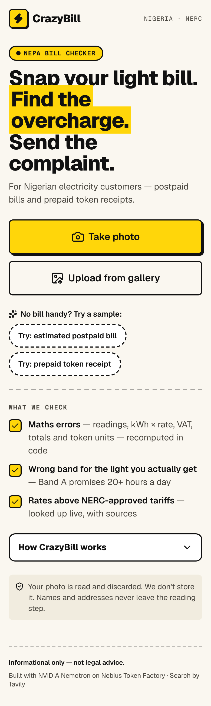
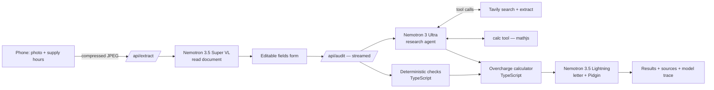

# CrazyBill

**Snap your light bill. Find the overcharge. Send the complaint.**

[](LICENSE)

Live demo: `<url>` · Video: `<url>`



## The problem

Nigerian electricity customers are routinely overbilled: estimated ("crazy") bills with no meter reading, Band A tariffs charged to people who get nowhere near Band A's promised 20 hours of light a day, wrong rates on prepaid tokens, and plain arithmetic errors. NERC rules give customers real rights — band downgrades, refunds, compensation — but almost nobody knows the rules or how to complain. CrazyBill turns a photo into a sourced audit and a ready-to-send complaint.

## What it does

1. **Photo** — take or upload a photo of a postpaid bill or prepaid token receipt (or tap a sample).
2. **Questions** — while the photo is being read: your DisCo, how many hours of light you've had per day, for how many days, and your meter situation.
3. **Review** — check the fields Nemotron read; low-confidence fields are highlighted.
4. **Audit** — deterministic maths checks → a research agent (Nemotron 3 Ultra + Tavily) finds the current NERC tariff, band hours and complaint rules → code calculates the ₦ overcharge.
5. **Results** — verdict, ₦ overcharge with formulas, findings with sources, an editable complaint letter (copy / download / print / WhatsApp), a Pidgin summary, and a model trace.

## How it works



The audit streams NDJSON events (`step`, `tool`, `result`) so the user watches each Tavily search happen live.

## How we use NVIDIA Nemotron on Nebius Token Factory

All inference runs on **Nebius Token Factory** (one OpenAI-compatible endpoint) using **NVIDIA Nemotron** models. No other LLM provider is used anywhere.

| Step | Model (env var) | Why this model | Typical latency / tokens |
|---|---|---|---|
| Read the bill photo | Nemotron 3.5 Super VL (`MODEL_VISION`), fallback Nemotron 3 Nano Omni (`MODEL_VISION_FALLBACK`) | Vision-language model; reads tables and small print, returns structured JSON | `[fill from npm run smoke]` |
| Research agent | Nemotron 3 Ultra (`MODEL_REASON`) | Strongest reasoning + tool calling; plans searches, reads NERC pages, decides band vs. supply | `[fill from npm run smoke]` |
| Letter + Pidgin, JSON repair | Nemotron 3.5 Lightning (`MODEL_FAST`) | Fast and cheap for writing tasks; letter and Pidgin run in parallel | `[fill from npm run smoke]` |

**Routing:** fast, cheap models for reading and writing; Nemotron 3 Ultra exactly once per audit for tool-using research. Models are swappable by env var. Every call is recorded in a trace (model, latency, tokens, estimated cost) that the user can open on the results screen — typical cost per audit: `[fill from npm run smoke]`.

**Robustness:** `src/lib/capabilities.ts` records what each model supports (JSON-schema output, tool calls, thinking switch), written by `npm run probe`. At runtime `src/lib/llm.ts` degrades gracefully (`json_schema` → `json_object` → prompt-only) if a mode is rejected, strips `<think>` blocks / `reasoning_content`, retries once on 429/5xx/timeouts, and the vision step falls back to a second model. Reasoning is never shown to users.

## How we use Tavily

Tavily is the agent's window onto current rules — tariffs change, so nothing is hardcoded.

- **`tavily_search`** (advanced depth, optional `includeDomains` such as `nerc.gov.ng`) and **`tavily_extract`** (≤3 URLs, most relevant paragraphs kept) are the agent's tools.
- **Source registry (anti-hallucination):** every URL returned by Tavily in that run is registered. After the agent answers, any `sourceUrl` it cites that Tavily did not actually return is removed and that item is marked low-confidence. Only sourced tariffs are used in ₦ maths. The count of stripped URLs is recorded in the trace.
- The user sees every source (title, domain, what it was used for) and the exact search queries the agent ran.

## Trust and safety

- **Code does all ₦ maths.** The LLM never calculates the overcharge; it only finds sourced rates and rules. Formulas are shown.
- **Citations are validated** against what Tavily actually returned.
- **Personal data is redacted** before research: name, address and full account number never reach the agent or Tavily (only the last 4 digits). The name/address are filled into the letter on the phone.
- **Images are never stored or logged** — processed in memory and discarded. No accounts, no database.
- **Not legal advice.** Wording is "you may be entitled to ask for…", never "you will get…".
- Rate limited per IP plus a daily cap on live audits; samples fall back to a saved run when the live service is busy.

## Run locally

Requires Node 20+.

```bash
git clone <repo-url> crazybill && cd crazybill
npm i
cp .env.example .env.local   # add NEBIUS_API_KEY and TAVILY_API_KEY
npm run list-models          # confirm the Nemotron model IDs exist
npm run probe -- --write     # record model capabilities
npm run dev
```

| Script | What it does |
|---|---|
| `npm run list-models` | Lists Nemotron models on Token Factory; checks the env model IDs exist |
| `npm run probe` | Probes vision, JSON modes, tool calling, reasoning shape, latency (`-- --write` updates `capabilities.ts`) |
| `npm run make-samples` | Renders the two synthetic sample documents to `public/samples/*.png` |
| `npm run precompute-samples` | Runs the live pipeline on both samples and saves the cached fallback runs |
| `npm run smoke` | Live end-to-end test on both samples (`-- --url https://…` to test a deployment) |
| `npm test` | Unit tests (vitest): checks, overcharge, verdict, JSON parsing, source registry, agent loop |

## Project structure

```
src/app/            page, layout, OG image, /api/extract, /api/audit (NDJSON stream), /api/health
src/components/     upload → questions → review → progress → results (letter, Pidgin, sources, trace)
src/lib/            llm wrapper, extraction, checks, overcharge, verdict, agent, tavily + source registry,
                    letter, redaction, rate limiting, streaming
scripts/            list-models, probe, make-samples, precompute-samples, smoke
tests/              vitest unit tests
docs/               DEVPOST.md, VIDEO_SCRIPT.md
DECISIONS.md        one line per non-obvious decision
```

## Limitations

- Tariffs and NERC orders change; results are only as current as the pages Tavily finds.
- Extraction depends on photo quality — that's why every field is editable.
- Supply hours are self-reported.
- Not every DisCo publishes its tariffs clearly; when a rate can't be sourced, no ₦ figure is claimed for it.
- Rate limits are in-memory per server instance.

## What's next

- WhatsApp bot for daily supply-hours logging (better evidence than memory).
- Crowd-sourced, feeder-level supply data to spot whole feeders billed in the wrong band.
- Nebius Serverless Jobs to refresh NERC tariff orders nightly.
- Deploy models on Nebius Serverless Endpoints.
- Hausa, Yoruba and Igbo.
- Bulk mode for estate managers and landlords.

## Feedback on Nebius Token Factory and NVIDIA models

Observations from building CrazyBill (Phase 0 probe results go here — run `npm run probe` and paste the table):

- **Model IDs:** we started from model IDs on a third-party listing; `npm run list-models` checks them against the live `/models` catalog. `[Greg: add — were any IDs different?]`
- **Structured output:** which `response_format` modes worked per model (`json_schema` / `json_object` / prompt-only). `[Greg: add from probe]`
- **Tool calling:** Nemotron 3 Ultra tool-call behaviour (parallel calls? argument JSON quality?). `[Greg: add]`
- **Reasoning output:** `<think>` in content vs. `reasoning_content`, and whether a thinking on/off switch worked. `[Greg: add from probe]`
- **Latency:** `[Greg: add from probe/smoke]`
- **Docs gaps / wishes:** `[Greg: add]`
- Having one OpenAI-compatible endpoint for vision, reasoning and fast models made routing trivial — the whole app uses one client.

## Built during the submission period

Created from scratch during the hackathon submission period (October 2026).

## License

[MIT](LICENSE) © 2026 Emediong Etuk Gregory
